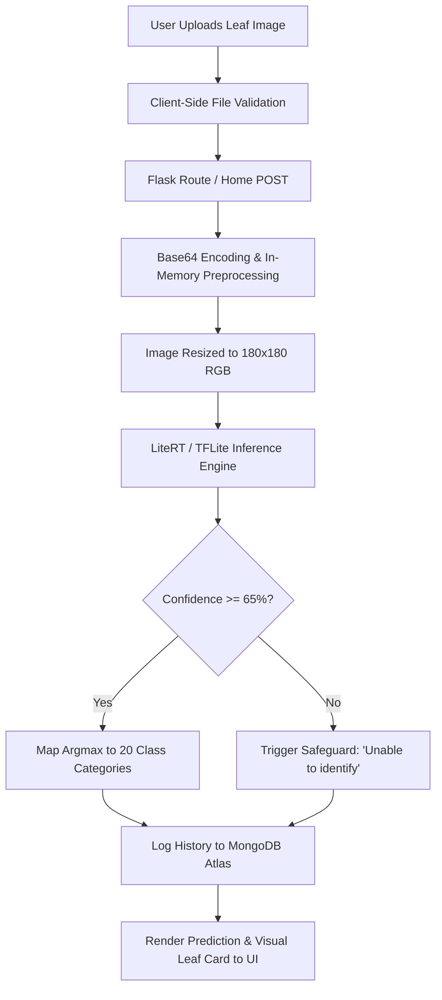

<div align="center">

# 🌿 SmartPlant-AI: Intelligent Crop Health & Disease Detection

[](https://www.python.org/)
[](https://flask.palletsprojects.com/)
[](https://ai.google.dev/edge/litert)
[](https://www.mongodb.com/atlas)
[](https://render.com)


**SmartPlant-AI** is an end-to-end, deep learning-powered agronomy web application engineered to diagnose foliar plant diseases instantly from leaf imagery. Designed with edge-optimized machine learning architectures, responsive mobile-first UI, and secure authentication, it enables farmers, agronomists, and gardening enthusiasts to detect crop infections before they spread.

---

### 🌐 Live Demo & Deployment

Experience the real-time crop disease diagnosis platform live in production:

[](https://smartplant-ai-2bkq.onrender.com)

> **Live URL:** [https://smartplant-ai-2bkq.onrender.com](https://smartplant-ai-2bkq.onrender.com/)  
> *Note: Hosted on Render Free Tier. If the server is spinning down after inactivity, please allow 30–50 seconds for the initial wake-up.*

---

</div>

## 📌 Table of Contents
- [Key Features](#-key-features)
- [System Architecture & Workflow](#-system-architecture--workflow)
- [Technologies & Libraries Used](#-technologies--libraries-used)
- [Supported Crops & Detectable Diseases](#-supported-crops--detectable-diseases)
- [Smart Confidence Thresholding](#-smart-confidence-thresholding)
- [Project Directory Structure](#-project-directory-structure)
- [Local Installation & Setup](#-local-installation--setup)
- [Deployment on Render](#-deployment-on-render)
- [Contributing](#-contributing)
- [Support & Star](#-support--star)

---

## ✨ Key Features

- **⚡ Ultra-Fast Edge Inference**: Utilizes a highly quantized **TensorFlow Lite (LiteRT)** model operating at under 60 MB RAM footprint, eliminating server timeouts and out-of-memory crashes.
- **🛡️ Out-of-Distribution / Non-Leaf Guard**: Incorporates a **65% confidence threshold check** that filters non-leaf uploads, random noise, and low-quality captures with an *"Unable to identify"* safe fallback.
- **🔐 User Authentication**: Secure registration, login, session hashing via Werkzeug security (`pbkdf2:sha256`), and personalized multi-user prediction logs.
- **📊 Real-Time Diagnostic History**: Syncs with **MongoDB Atlas** to track timestamped leaf captures, prediction outcomes, and confidence percentages in an intuitive collapsible sidebar.
- **🌓 Light & Dark Theme Support**: Native adaptive interface toggle with local storage memory and smooth CSS transition states.
- **📱 Fully Responsive Mobile Drawer**: Zero-overflow dynamic viewport layout (`100dvh`) with gesture-friendly slide-over drawers and backdrop dismissals.

---

## 🏗️ System Architecture & Workflow



---

## 🛠️ Technologies & Libraries Used

| Category | Technology / Library | Purpose |
| :--- | :--- | :--- |
| **Backend Framework** | **Flask (3.0.3)** | Lightweight WSGI web application routing and templating |
| **WSGI Server** | **Gunicorn (22.0.0)** | Production concurrency manager configured for worker/thread efficiency |
| **Deep Learning** | **Keras 3.x / TensorFlow 2.x** | Model design, convolutional training, and SavedModel export |
| **Inference Runtime** | **Google LiteRT (`ai-edge-litert`)** | Minimalist C++ based inference runtime tailored for <512MB RAM servers |
| **Database** | **MongoDB Atlas & PyMongo** | Cloud document database for storing user profiles and inference records |
| **Image Processing** | **Pillow (PIL) & NumPy** | In-memory byte conversion, tensor reshaping, and matrix array normalization |
| **Frontend** | **HTML5, Modern CSS3, Vanilla JS** | Modern design tokens, dynamic viewport units (`100dvh`), and DOM controls |
| **Icons & Typography** | **FontAwesome 6.7.2** | Clean vector iconography and agro-themed UX cues |

---

## 🔬 Supported Crops & Detectable Diseases

The model is trained on tens of thousands of curated crop leaf images, accurately categorizing **20 distinct classes** spanning 4 major agricultural staples:

### 🍎 Apple
1. **Apple Scab** (`Venturia inaequalis`)
2. **Black Rot** (`Botryosphaeria obtusa`)
3. **Cedar Apple Rust** (`Gymnosporangium juniperi-virginianae`)
4. **Healthy Apple Foliage**

### 🌽 Corn (Maize)
5. **Cercospora Leaf Spot / Gray Leaf Spot** (`Cercospora zeae-maydis`)
6. **Common Rust** (`Puccinia sorghi`)
7. **Northern Leaf Blight** (`Exserohilum turcicum`)
8. **Healthy Corn Foliage**

### 🥔 Potato
9. **Early Blight** (`Alternaria solani`)
10. **Late Blight** (`Phytophthora infestans`)
11. **Healthy Potato Foliage**

### 🍅 Tomato
12. **Bacterial Spot** (`Xanthomonas perforans`)
13. **Early Blight** (`Alternaria solani`)
14. **Late Blight** (`Phytophthora infestans`)
15. **Leaf Mold** (`Passalora fulva`)
16. **Septoria Leaf Spot** (`Septoria lycopersici`)
17. **Target Spot** (`Corynespora cassiicola`)
18. **Tomato Yellow Leaf Curl Virus** (TYLCV)
19. **Tomato Mosaic Virus** (ToMV)
20. **Healthy Tomato Foliage**

---

## 🎯 Smart Confidence Thresholding

Standard neural networks often suffer from overconfidence when exposed to out-of-distribution (OOD) graphics, wallpapers, or non-crop objects. 

To ensure agronomical reliability:
* **Confidence $\ge$ 65%**: High certainty diagnosis displayed with pathogen identification and actionable agronomist advisory alerts.
* **Confidence $<$ 65%**: System triggers safety fallback:
  > *"Unable to identify / Not a valid plant leaf"*
  
  Alerts the user to re-capture under uniform lighting without recommending unnecessary chemical treatments.

---

## 📂 Project Directory Structure

```text
PlantCare AI/
├── model/
│   ├── plant_disease.tflite          # Quantized LiteRT weights (~1.6MB)
│   └── class_names.json              # Canonical 20-class index schema
├── static/
│   ├── css/
│   │   └── style.css                 # Responsive light/dark CSS3 stylesheet
│   └── js/
│       └── script.js                 # Drag-and-drop & sidebar toggle handler
├── templates/
│   ├── index.html                    # Core analysis workspace & dashboard
│   ├── login.html                    # Account authentication page
│   └── register.html                 # New user sign-up page
├── .env                              # configuration environment variables
├── .gitignore                        # Git exclusion rules
├── .python-version                   # Pinned runtime version (3.10.10)
├── app.py                            # Flask server, MongoDB hooks & LiteRT pipeline
├── requirements.txt                  # Production dependencies
└── README.md                         # Project documentation
```

---

## 💻 Local Installation & Setup

### Prerequisites
- Python `3.10.x` installed
- Git installed
- MongoDB Atlas cluster URI or local MongoDB daemon

### 1. Clone the Repository
```bash
git clone https://github.com/KarthikJ-2008/SmartPlant-Ai.git
cd SmartPlant-Ai
```

### 2. Create and Activate a Virtual Environment
```bash
# Windows
python -m venv .venv
.venv\Scripts\activate

# macOS / Linux
python3 -m venv .venv
source .venv/bin/activate
```

### 3. Install Required Dependencies
```bash
pip install --upgrade pip
pip install -r requirements.txt
```

### 4. Configure Environment Variables
Create a `.env` file in the root directory:
```ini
SECRET_KEY=your_custom_secret_key_here
MONGO_URI=mongodb+srv://<username>:<password>@cluster0.mongodb.net/plantcare_db?retryWrites=true&w=majority
PORT=5000
```

### 5. Launch the Application
```bash
python app.py
```
Open your browser and navigate to `http://127.0.0.1:5000/`.

---

## ⭐ Support & Star

If this project helped you learn deep learning deployment, assisted your academic research, or protected your crops, please give it a **Star**! ⭐ It helps the project reach more agricultural communities.

<div align="center">

[](https://github.com/KarthikJ-2008/SmartPlant-Ai)

**Developed by [Karthik J](https://github.com/KarthikJ-2008)**
Connect and **follow** along with my upcoming projects on GitHub.

</div>
